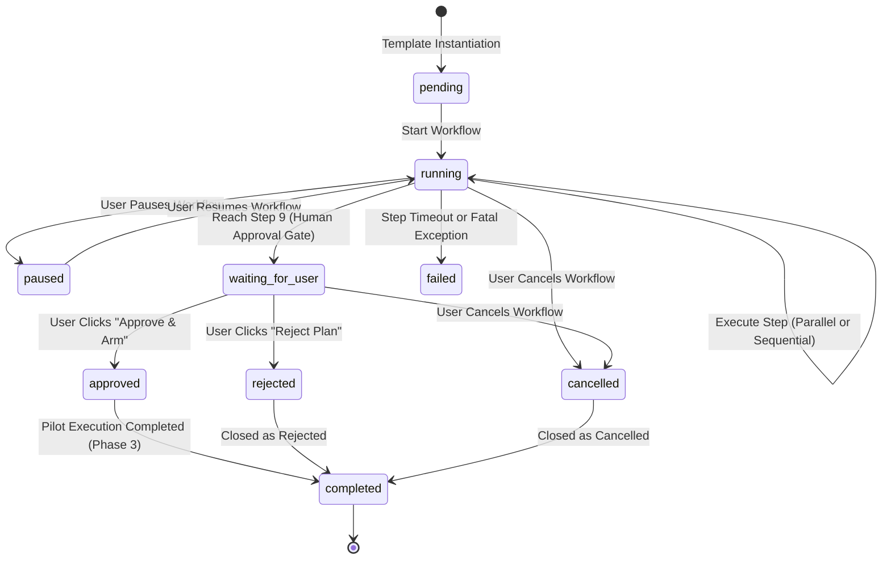
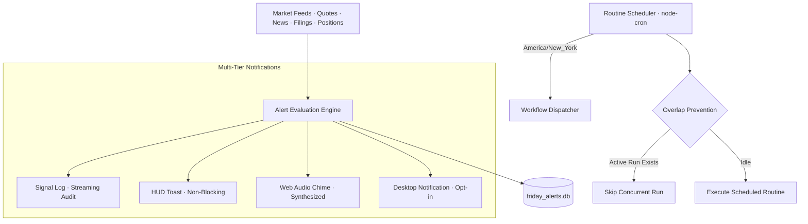
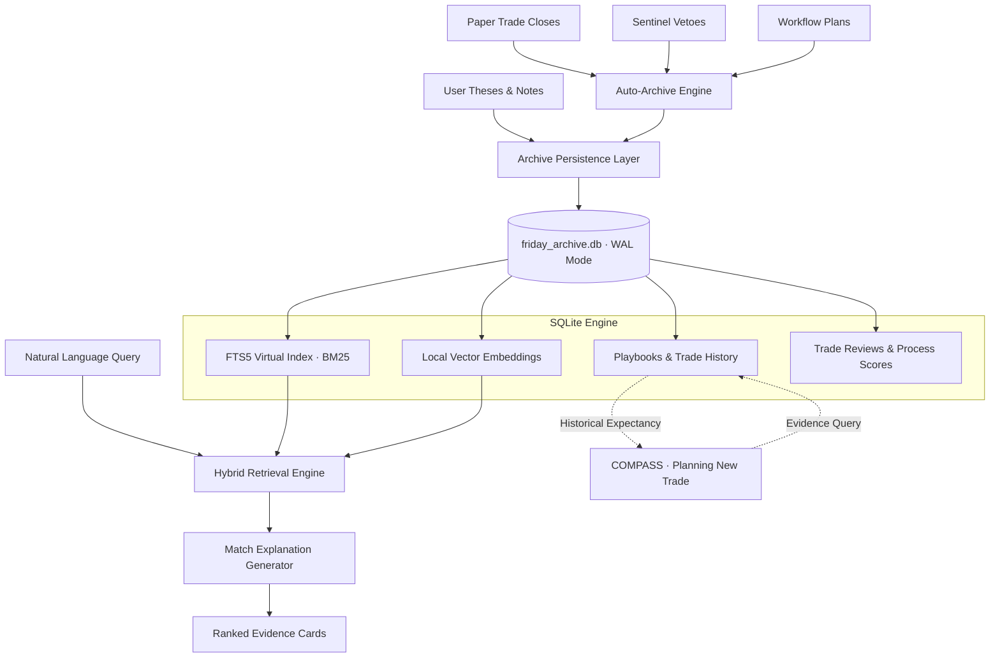

# F.R.I.D.A.Y. 2.0 System Architecture

> **Deterministic Multi-Agent Research, Risk Review, and Workflow Orchestration Desk**  
> *Paper Trading Only · Educational & Research Co-Pilot · Non-Custodial*

---

## 1. High-Level System Architecture

F.R.I.D.A.Y. 2.0 is built on a hub-and-spoke multi-agent topology supervised by a central Master Orchestrator and powered by a deterministic, persistent state machine in `/master/workflow`.

```mermaid
graph TD
    User([User Voice / Text]) --> Master[F.R.I.D.A.Y. Master Orchestrator]
    Master --> WorkflowEngine[Workflow State Machine]

    subgraph Parallel Intelligence Stage [Parallel Execution Group]
        Atlas[ATLAS · Macro & Rates]
        Newsroom[NEWSROOM · News & SEC 8-K]
        Athena[ATHENA · Fundamentals & 10-K/Q]
        Chartist[CHARTIST · Multi-TF Technicals]
        Oracle[ORACLE · Probabilistic Quant]
    end

    WorkflowEngine --> ParallelIntelligenceStage
    ParallelIntelligenceStage --> Compass[COMPASS · Trade Planner]
    Compass --> Sentinel[SENTINEL · Risk Officer]
    Sentinel --> HumanGate{Human Approval Gate}
    HumanGate -- Rejected / Vetoed --> Abort([Workflow Terminated])
    HumanGate -- Explicit User Approval --> Pilot[PILOT · Execution Engine (Phase 3)]
    Pilot --> Ledger[LEDGER · Performance & Journal]
```

---

## 2. Agent Roster & Authority Matrix

| Agent | Domain / Responsibility | Input Data | Output Contract | Execution Authority |
| :--- | :--- | :--- | :--- | :--- |
| **F.R.I.D.A.Y.** | Master Orchestrator & Speech Synthesizer | User intent, agent outputs | Spoken summary, view routing | **Supervisory Only** |
| **ATLAS** | Macro environment, Fed rates, CPI, yields | Macro feeds, treasury rates | Regime & policy context | **None (Read-Only)** |
| **NEWSROOM** | Live breaking news, SEC 8-K filings | Finnhub news, RSS, SEC | Catalyst timeline & sentiment | **None (Read-Only)** |
| **ATHENA** | Financial statements, earnings, 10-K/Q | SEC EDGAR, filings | Fundamental health & valuation | **None (Read-Only)** |
| **CHARTIST** | Key S/R, liquidity, trend, indicators | OHLCV, TradingView MCP | Technical levels & structure | **None (Read-Only)** |
| **ORACLE** | Probability cones, statistical confidence | Historical volatility, distributions | Expected price bounds `(model-estimated)` | **None (Read-Only)** |
| **COMPASS** | Trade planning & invalidation drafting | Multi-agent research bundle | `TradePlanSchema` (Zod validated) | **Strictly Prohibited** |
| **SENTINEL** | Risk checks, position limits, drawdown | Draft trade plan, portfolio state | `SentinelVerdictSchema` (Approve/Modify/Veto) | **Veto Authority** |
| **PILOT** | Paper order matching & execution | Approved plan + Signed HMAC token | Paper execution tickets | **Paper Only (Phase 3)** |
| **LEDGER** | Trade journaling, paper P&L, audits | Paper execution stream | P&L records, performance metrics | **Audit Only** |
| **RELAY** | Alert & routine manager, desk watchtower | Quotes, indicators, filings, calendar, positions | `AlertSchema`, `RoutineSchema`, `AlertTriggerEventSchema` | **Strictly Prohibited** |
| **ARCHIVE** | Research librarian, playbooks, trade memory | Theses, notes, reviews, playbooks, trade history | `ResearchItemSchema`, `PlaybookSchema`, `TradeReviewSchema` | **Strictly Prohibited** |
| **SENTINEL-X** | Portfolio risk officer, heat, correlation, kill switch | Book positions, return series, risk budgets, stress shocks | `PortfolioSnapshotSchema`, `PortfolioHeatSchema`, `KillSwitchStateSchema` | **Veto & Halt Authority (No Execution)** |

---

## 3. Workflow State Machine (`master/workflow`)

The workflow engine implements a deterministic state machine with complete persistence, rollback safety, and audit logging.

### State Transitions



### Persistence Layer (`master/workflow/sqlitePersistence.js`)

All workflow data is stored in SQLite (using Node 22 native `node:sqlite` or SQLite3 adapter) across 4 relational tables:

1. **`workflows`**: Top-level workflow instances.
   - `id` (TEXT PRIMARY KEY): Unique UUID (`wf_...`).
   - `template_name` (TEXT): Template identifier (e.g., `plan_equity_swing_trade`).
   - `ticker` (TEXT): Target instrument symbol (e.g., `AAPL`, `NVDA`).
   - `status` (TEXT): `pending`, `running`, `waiting_for_user`, `approved`, `rejected`, `cancelled`, `completed`, `failed`.
   - `current_step_index` (INTEGER): Pointer to active step.
   - `error` (TEXT): Failure reason if aborted.
   - `created_at`, `updated_at` (INTEGER): Unix millisecond timestamps.

2. **`workflow_steps`**: Granular execution steps.
   - `id` (TEXT PRIMARY KEY): Unique step UUID.
   - `workflow_id` (TEXT): Foreign key to `workflows.id`.
   - `step_index` (INTEGER): Deterministic sequence order.
   - `agent` (TEXT): Assigned specialist (`ATLAS`, `COMPASS`, etc.).
   - `name` (TEXT): Human-readable task description.
   - `status` (TEXT): `pending`, `running`, `completed`, `waiting_for_user`, `failed`, `skipped`.
   - `parallel_group` (TEXT): Parallel grouping tag (e.g. `market_intelligence`).
   - `inputs` (TEXT): JSON-serialized input parameters.
   - `outputs` (TEXT): JSON-serialized step artifact/output.
   - `error` (TEXT): Step-specific error or timeout message.
   - `started_at`, `completed_at` (INTEGER): Execution timing.

3. **`workflow_events`**: Append-only tamper-evident event log.
   - `id` (INTEGER PRIMARY KEY AUTOINCREMENT).
   - `workflow_id` (TEXT): Foreign key.
   - `event_type` (TEXT): `workflow_started`, `step_started`, `step_completed`, `step_failed`, `plan_synthesized`, `risk_evaluated`, `user_decision`, `workflow_completed`.
   - `step_id` (TEXT): Associated step.
   - `payload` (TEXT): JSON event details.
   - `created_at` (INTEGER): Timestamp.

4. **`workflow_artifacts`**: Key domain models generated during workflows.
   - `id` (TEXT PRIMARY KEY).
   - `workflow_id` (TEXT): Foreign key.
   - `artifact_type` (TEXT): `trade_plan`, `sentinel_verdict`, `macro_brief`, `technical_analysis`.
   - `data` (TEXT): Zod-validated JSON payload.
   - `created_at` (INTEGER): Timestamp.

---

## 4. End-to-End Trade Planning Pipeline (`plan_equity_swing_trade`)

The default trade-planning workflow coordinates 10 deterministic steps:

```
Step 1: clarify_intent (F.R.I.D.A.Y.)
        ↓
Step 2: gather_macro (ATLAS) ──┐
Step 3: gather_news (NEWSROOM)  ├─ Parallel Group: market_intelligence
Step 4: gather_filings (ATHENA) │  (Concurrent async execution with 8000ms timeouts)
Step 5: analyze_chart (CHARTIST)│
Step 6: quantify_outlook (ORACLE)
        ↓
Step 7: draft_trade_plan (COMPASS)
        ↓
Step 8: risk_review (SENTINEL)
        ↓
Step 9: wait_for_user (USER GATE · Strict Safety Boundary)
        ↓
Step 10: paper_execute (PILOT · Deferred to Phase 3)
```

### Detailed Pipeline Flow

1. **Step 1: Intent Parsing (`F.R.I.D.A.Y.`)**:
   - Parses the user request (e.g., *"Plan a swing trade in AAPL"*).
   - Validates ticker symbol, target setup type (`swing`, `breakout`, `pullback`), and horizon.

2. **Steps 2–6: Concurrent Intelligence Gathering**:
   - Dispatched in parallel via `Promise.allSettled`.
   - Each step operates under a strict timeout (default: 8000ms).
   - If an agent times out or data is missing, the step gracefully degrades with `"—"` missing markers and explicit gap notes; it never fabricates data.

3. **Step 7: Trade Plan Synthesis (`COMPASS`)**:
   - Assembles outputs from ATLAS, NEWSROOM, ATHENA, CHARTIST, and ORACLE.
   - Computes:
     - Entry trigger (e.g., break above resistance, pullback to support).
     - Directional stop-loss based on structural invalidation levels.
     - Take-profit targets (Target 1 for partial profit, Target 2 runner).
     - Mathematical Reward-to-Risk ratio ($R:R = \frac{|\text{Target 1} - \text{Entry}|}{|\text{Entry} - \text{Stop}|}$).
     - Suggested position size based on 1% default account risk.
     - Clear structural thesis invalidations.
   - Validates against `TradePlanSchema` (Zod).

4. **Step 8: Independent Risk Review (`SENTINEL`)**:
   - Evaluates the draft trade plan against immutable safety rules:
     - Mandatory directional stop-loss present.
     - Minimum Reward-to-Risk ratio $\ge 1.5R$.
     - Maximum position risk $\le 2\%$ of account equity.
     - Imminent event conflict check (earnings or major catalyst within 24–48 hours).
   - Emits a `SentinelVerdictSchema`:
     - `approve`: Plan satisfies all risk parameters.
     - `modify`: Plan requires adjustments (e.g., tighten stop or reduce sizing).
     - `veto`: Plan violates hard risk boundaries.

5. **Step 9: Human Confirmation Safety Gate (`USER`)**:
   - The workflow engine sets status to `waiting_for_user` and **halts execution**.
   - The HUD renders the interactive `WorkflowTimeline` and `TradePlanCard`.
   - **Veto Enforcement**: If Sentinel issued a `veto`, the "Approve & Arm" button is permanently disabled with a clear warning explaining the risk violation.
   - A human user must click "Approve" or "Reject".

6. **Step 10: Execution Hand-off (Phase 3)**:
   - In Phase 2.5, Step 10 completes the plan workflow without routing to PILOT.
   - In future phases, PILOT will only accept orders bearing a valid cryptographic signature issued upon user confirmation.

---

## 5. Data Flow & Security Contract Validation

All cross-agent communication is validated using Zod schemas defined in `shared/contract.js`:

- **`TradePlanSchema`**: Enforces required fields (`id`, `symbol`, `direction`, `timeframe`, `thesis`, `entry`, `stop`, `targets`, `positionSize`, `invalidation`, `confidence`, `sources`).
- **`SentinelVerdictSchema`**: Enforces strict verdict types (`verdict`, `score`, `checks`, `violations`, `timestamp`).
- **`WorkflowStateSchema`**: Enforces complete lifecycle state integrity.
- **`AlertSchema` & `RoutineSchema`**: Validates alert configurations, routine schedules, and triggered event envelopes.

Missing or unconfirmed data points are represented explicitly as `"—"` or `null` with attached disclosure chips, preventing hallucinated prices or phantom levels from reaching risk review.

---

## 6. RELAY Alert Watchtower & Routine Architecture (Phase 5.5)



### 1. Alert Evaluation Engine (`services/alerts/evaluator.js`)
- **Event-Driven & Multi-Source**: Evaluates alerts on every quote tick, news wire, SEC filing, calendar update, paper position update, and data-health state change.
- **True Crossing Detection**: Requires historical state comparison ($prev \le threshold \land current > threshold$). Does not fire if price was already beyond threshold at creation unless explicitly flagged.
- **Active Hours & Timezone**: Restricts firing to configured market sessions (e.g. `09:30 - 16:00 America/New_York`).
- **Stale Quote Protection**: Automatically blocks price/indicator alerts when quote data is flagged as stale.
- **Deduplication**: Enforces strict event signature tracking preventing redundant triggers on the same filing accession number or news story.

### 2. Timezone-Aware Routine Scheduler (`services/alerts/routineScheduler.js`)
- **Native CRON Execution**: Built on `node-cron` with explicit timezone binding to `America/New_York`.
- **Overlap Prevention**: Maintains an in-memory execution registry (`runningRoutines`). If a routine is still executing from a previous tick, overlapping runs are gracefully skipped.
- **Default Seed Routines**:
  1. `Pre-market briefing`: Weekdays, 09:00 ET (`0 9 * * 1-5`)
  2. `Market-open checklist`: Weekdays, 09:30 ET (`30 9 * * 1-5`)
  3. `Midday risk check`: Weekdays, 13:00 ET (`0 13 * * 1-5`)
  4. `Post-market review`: Weekdays, 16:15 ET (`15 16 * * 1-5`)
  5. `Weekly journal review`: Friday, 17:00 ET (`0 17 * * 5`)

### 3. SQLite Persistence Layer (`services/alerts/alertPersistence.js`)
- `alerts`: Stores alert definitions, conditions, triggers, actions, and current status (`active`, `paused`, `triggered`, `expired`).
- `routines`: Stores routine schedules, cron expressions, workflow bindings, and execution timestamps.
- `alert_events`: Tamper-evident append-only trigger history with severity ratings (`info`, `important`, `critical`).

---

## 7. ARCHIVE Research Memory & Playbook Architecture (Phase 6.5)



### 1. SQLite Relational & Virtual Schema (`services/archive/archivePersistence.js`)
Operates under WAL mode (`PRAGMA journal_mode=WAL`) across 9 relational and full-text tables:
1. **`research_items`**: Core research items (theses, notes, chart snapshots, trade plans, reviews, playbooks, weekly reviews) with strict Zod validation.
2. **`research_items_fts`**: FTS5 virtual table indexing `title`, `symbol`, `thesis`, `body`, `tags`, `setup`, and `market_regime` using BM25 ranking.
3. **`research_links`**: Relational bridge linking research items to trades, workflows, news articles, and SEC filings.
4. **`playbooks`**: Repeatable trading setups containing rules (entry, invalidation, stop, target, sizing) and verified performance metrics.
5. **`playbook_trades`**: Associative junction binding closed trades to playbook records.
6. **`trade_reviews`**: Detailed post-trade reviews with objective process and discipline scores, what went right/wrong, mistakes, and lessons.
7. **`archive_embeddings`**: Local vector store supporting 64-dimensional dense vectors and cosine similarity search.
8. **`archive_tags`**: Tag index supporting multi-tag search and autocomplete.
9. **`archive_events`**: Relational event markers linking trades and notes to macro catalyst dates (e.g. CPI, FOMC).
10. **`archive_exports`**: Audit log recording timestamp, export format (Markdown, JSON, CSV), and record counts.

### 2. Hybrid Retrieval Engine (`services/archive/retrieval.js`)
Blends 5 signals into a single relevance score with a human-readable match explanation:
- **Exact Symbol Match** ($+3.0$ weight)
- **Tag Overlap** ($+2.0$ per matching tag)
- **FTS5 Keyword Relevance** ($+2.5 \times \text{BM25}$)
- **Local Semantic Similarity** ($+2.0 \times \text{Cosine Similarity}$)
- **Recency Decay** (exponential decay halving over 90 days)
- **Transparent Output**: Every result includes `match_reason`, e.g.:
  > *"Matched because it shares symbol NVDA, tag 'breakout', keyword relevance (score 4.8), and high semantic similarity (0.89)."*

### 3. Playbook Engine (`services/archive/playbookEngine.js`)
- Groups historical closed trades by setup, timeframe, and market regime.
- Calculates verified mathematical expectancy:
  $$\text{Expectancy} = (\text{Win Rate} \times \text{Average Win}) - (\text{Loss Rate} \times \text{Average Loss})$$
  $$\text{Profit Factor} = \frac{\sum \text{Gross Profits}}{\sum \text{Gross Losses}}$$
- Extracts observed rule patterns from trades (entry trigger, invalidation, stop placement, targets).
- Provides evidence directly to COMPASS during new trade generation without giving execution advice.

### 4. Trade Review & Process Score Engine (`services/archive/reviewEngine.js`)
- Transparent 10-point process scoring ($0–100$ scale) based on objective trading discipline:
  1. Written thesis established (+10)
  2. Defined invalidation level (+10)
  3. Pre-set stop-loss at entry (+15)
  4. Position size respected risk limit (+10)
  5. Stop-loss never moved against position (+15)
  6. Planned exit followed (+10)
  7. Avoided event-risk violations (+10)
  8. Avoided revenge entry after a loss (+10)
  9. Avoided overtrading (+5)
  10. Completed post-trade review (+5)
- Discipline score calculates execution faithfulness ($100 - \sum \text{penalties}$).
- Objective separation: High process score can coexist with a losing trade, and winning trades can receive low process scores for poor discipline.

---

## 8. SENTINEL-X Portfolio Risk & Correlation Architecture (Phase 7.5)

```mermaid
graph TD
    Proposal[New Trade Proposal] --> TradeGate{SENTINEL Level 1: Trade Check}
    TradeGate -- Stop missing or R:R < 1.5R --> Veto1([VETO / MODIFY])
    TradeGate -- Approved --> PortGate{SENTINEL-X Level 2: Portfolio Check}
    
    subgraph SENTINEL-X Portfolio Engine
        KillSwitchCheck{Kill Switch Active?}
        HeatModel[Portfolio Heat: sum(|Entry - Stop| * Qty)]
        ConcEngine[Concentration & Cluster Auditor]
        CorrEngine[Rolling Returns Correlation Matrix]
        StressEngine[Scenario Stress Tester]
        BudgetEngine[Daily & Weekly Risk Budget]
    end

    PortGate --> KillSwitchCheck
    KillSwitchCheck -- Yes --> KillVeto([VETO: Kill Switch Active])
    KillSwitchCheck -- No --> HeatModel
    HeatModel --> ConcEngine
    ConcEngine --> CorrEngine
    CorrEngine --> StressEngine
    StressEngine --> BudgetEngine

    BudgetEngine -- Heat > 6% or Budget Exhausted --> PortVeto([VETO / MODIFY])
    BudgetEngine -- Within Limits --> DualApproved([Dual Risk Approved])
    DualApproved --> UserGate{Human Confirmation Gate}
    UserGate --> Pilot[PILOT Paper Order Execution]
```

### 1. Three-Tier Risk Philosophy
SENTINEL-X operationalizes risk across three distinct horizons:
1. **Trade Level (SENTINEL)**: Entry trigger, directional stop-loss, position sizing, minimum 1.5R reward:risk, structural invalidation.
2. **Portfolio Level (SENTINEL-X)**: Aggregated portfolio heat ($\sum \text{Risk}_i$), rolling returns correlation ($\rho$), sector concentration ($\le 3\%$), single-symbol concentration ($\le 2\%$), correlated cluster limits ($\le 4\%$), drawdown trajectory, and daily loss limits.
3. **Behavioral Level**: Overtrading detection, revenge sizing checks, risk budget exhaustion guards, and mandatory human confirmation gates.

### 2. Mathematical Heat & Exposure Model (`services/sentinel-x/portfolioRiskModel.js`)
Portfolio heat represents the maximum capital at risk if every active position simultaneously hits its stop-loss:
$$\text{Portfolio Heat} = \sum_{i=1}^n \text{Risk}_i = \sum_{i=1}^n |\text{Entry}_i - \text{Stop}_i| \times \text{Quantity}_i$$
- **Limits**:
  - `Hard Block`: 6.0% of current equity (new entries unconditionally blocked).
  - `Soft Warning`: 4.0% of current equity (triggers visual caution and heightened pretrade scrutiny).
  - `Sector Limit`: 3.0% of current equity per sector.
  - `Cluster Limit`: 4.0% of current equity per correlated cluster.
  - `Symbol Limit`: 2.0% of current equity per single ticker.

### 3. Returns-Based Correlation & Cluster Engine (`services/sentinel-x/correlationEngine.js`)
- **Return Series Formulation**: Correlation is computed from daily percentage returns ($R_t = \frac{P_t - P_{t-1}}{P_{t-1}}$), avoiding raw price co-trending fallacies.
- **Pearson Matrix**: Standard 60-day rolling lookback across all active assets. Requires $\ge 5$ common return periods; never fabricates missing history.
- **Cluster Detection**: Identifies shared-beta clusters across sectors (e.g., Semiconductors/AI Hardware: NVDA, AMD, SMCI) and macro risk factors (Crypto Beta, High-Beta Momentum).

### 4. Scenario Stress Testing Engine (`services/sentinel-x/stressTesting.js`)
- Evaluates non-linear shocks across 18 built-in scenarios (Market -1%/-2%/-5%/-10%, Tech -5%, Semis -5%, Dollar +1%, Yields +25bps, VIX +25%, Liquidity Shock, Gap Through Stop).
- Tracks stop breach states and provides transparent `MODEL-ESTIMATED (NOT A PREDICTION)` banners, methodology, assumptions, and limitations.

### 5. Risk Budgeting & The Kill Switch (`services/sentinel-x/riskBudget.js`, `services/sentinel-x/killSwitch.js`)
- **Risk States**: `GREEN` (Normal), `YELLOW` (Soft warning), `ORANGE` (Budget $\ge 80\%$ used), `RED` (Limit breached), `BLACK` (Kill switch active).
- **Kill Switch Safety Invariants**:
  - Unconditionally blocks all new order creations.
  - **Preserves all active protective stops and profit targets** to prevent unhedged market exposure.
  - Deactivation strictly requires explicit human confirmation and documented reasoning.

