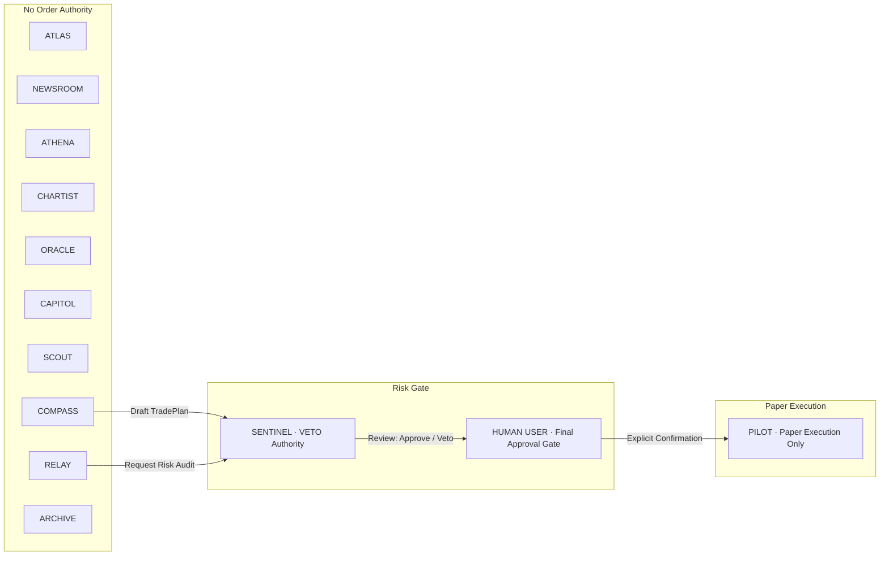

# F.R.I.D.A.Y. 2.0 Security & Risk Architecture

> **Security Policy, Isolation Boundaries, and Gated Execution Protocols**  
> *Paper Trading Only · Educational & Research Desk · No Financial Advice*

---

## 1. Core Security Model

F.R.I.D.A.Y. 2.0 is designed from the ground up as a research-first, paper-trading system. The desk enforces multi-tier security boundaries ensuring that under no circumstances can an AI agent, natural language prompt, or workflow automation execute unauthorized trades or connect to live broker capital.

### Non-Negotiable Guarantees

1. **`LIVE_TRADING=false` Enforced at Kernel Level**:
   - The central configuration (`shared/config.js`) hardcodes `LIVE_TRADING=false`.
   - No real-money brokerage APIs (e.g. Interactive Brokers TWS, Alpaca Live, TD Ameritrade live credentials) are configured, accessible, or routed within the codebase.
   - Any attempt to toggle live execution is blocked at runtime.

2. **Paper Trading Isolation**:
   - All simulated orders and fills exist solely within a local SQLite database table.
   - P&L, balance tracking, and execution fills are purely mathematical simulations.

---

## 2. Specialist Agent Authority & Execution Boundaries

Every specialist agent operates under the **Principle of Least Privilege**:



### Analysis Agent Veto
The analysis, memory, and watchtower agents (`COMPASS`, `ATHENA`, `CHARTIST`, `ORACLE`, `ATLAS`, `SCOUT`, `CAPITOL`, `NEWSROOM`, `RELAY`, `ARCHIVE`):
- Have **zero** access to execution endpoints or order book functions.
- Cannot place, cancel, or modify simulated orders.
- Cannot sign or forge risk approval tokens.
- Cannot alter account risk settings, max drawdown limits, or position sizes.

### COMPASS Security Invariant
`COMPASS` is a dedicated trade-planning agent. It receives market intelligence and synthesizes a structured `TradePlanSchema`. By design:
- It **never** contacts the paper execution engine.
- It **never** generates execution tokens.
- It always submits its draft output to `SENTINEL` for risk checking.

### RELAY Security Invariant (Phase 5.5)
`RELAY` is the desk's watchtower and routine manager. By hardcoded design:
- It can alert and stream notifications to the Signal Log, HUD toasts, and desktop.
- It can request an independent `SENTINEL` risk audit or trigger a read-only research workflow.
- It **never** places, modifies, fills, cancels, or approves any order or trade.
- It **never** alters risk parameters or drawdown thresholds.
- It cannot generate Sentinel cryptographic execution tokens or authorize PILOT.
- Any attempt to invoke order placement or trade approval through RELAY immediately triggers an immutable `SECURITY VIOLATION` exception.

### ARCHIVE Security & Privacy Invariant (Phase 6.5)
`ARCHIVE` is the desk's local research librarian and memory keeper. By hardcoded design:
- It **never** places, modifies, fills, cancels, or approves any order or trade (`assertArchiveCannotExecute`).
- All research notes, journal reflections, post-trade reviews, playbooks, and embeddings remain **strictly local** on the user's machine by default.
- No cloud synchronization, background telemetry, or external database push occurs unless explicitly confirmed by the user.
- **Zero Unsolicited LLM Access**: Private journal entries and personal notes are never transmitted to cloud LLMs (Gemini, Claude, GPT) unless the user explicitly commands an AI summary or review of that specific item.
- **Immediate Embedding Cascade**: Deleting an archived item immediately removes or invalidates its corresponding vector embedding and FTS5 search index record.
- **Sanitized Logging**: System logs strictly redact full private journal texts, personal notes, and high-dimensional vector embeddings.

---

## 3. The Single Gated Money Path

All trade executions (simulated paper orders) must travel through a strictly serial, cryptographically validated pipeline:

```
[Natural Language Request]
         ↓
[Parallel Intelligence Gathering (ATLAS, NEWSROOM, ATHENA, CHARTIST, ORACLE)]
         ↓
[COMPASS Synthesizes TradePlanSchema]
         ↓
[SENTINEL Independent Risk Audit]
         ↓
    [VETO?] ─── YES ───► [Execution Terminated · Approve Button Disabled]
         ↓ NO
[HUMAN USER Confirmation Gate (wait_for_user)]
         ↓
    [APPROVED?] ─── NO ───► [Workflow Cancelled / Rejected]
         ↓ YES
[HMAC-SHA256 Token Issuance]
         ↓
[PILOT Paper Order Execution (Phase 3)]
         ↓
[LEDGER Journal Audit]
```

### Immutable Sentinel Risk Rules
`SENTINEL` independently assesses every trade plan against hardcoded risk policies:
- **Mandatory Directional Stop-Loss**: Every trade plan must define a non-zero, directional stop-loss (Stop < Entry for Longs, Stop > Entry for Shorts). Plans without a stop are immediately vetoed.
- **Minimum Reward-to-Risk Ratio ($R:R \ge 1.5$)**: Plans offering less than 1.5R expected payoff are vetoed or forced to modify.
- **Maximum Account Risk ($\le 2\%$)**: The calculated dollar risk based on position size and stop-loss distance cannot exceed the account risk threshold.
- **Event Risk Quarantine**: Plans targeting stocks with imminent earnings announcements, FDA rulings, or major unscheduled binary catalysts within 24–48 hours are vetoed to avoid gap risk.

### Sentinel VETO Cannot Be Overridden
If `SENTINEL` issues a `veto`:
- The workflow state machine marks the risk review as failed.
- The UI frontend automatically **disables** the "Approve & Arm" button.
- The backend `/api/workflow/action` endpoint rejects any incoming approval payloads for a vetoed plan with HTTP 403 / Risk Violation.
- No human override or prompt manipulation can bypass a Sentinel veto.

---

## 4. Zero Secrets in Client Renderer

F.R.I.D.A.Y. enforces strict isolation between client-side UI code and backend execution environments:

1. **Environment Variables**:
   - API keys (Finnhub API key, Gemini API key, HMAC signing secrets) reside exclusively in `.env` read by Node.js server processes.
   - `.env` is explicitly registered in `.gitignore` and is never bundled into client JavaScript.
2. **Electron IPC Bridge**:
   - Electron shell runs with `contextIsolation: true` and `nodeIntegration: false`.
   - Communication between the HUD frontend and the operating system occurs exclusively over a sanitized IPC bridge (`preload.js`) with explicit channel whitelisting.
3. **No Direct Database Access from UI**:
   - The browser / HUD has zero direct connection to SQLite.
   - All state mutations occur through validated REST API endpoints (`/api/workflows`, `/api/workflow/action`).

---

## 5. Anti-Hallucination & Model Honesty

To eliminate financial hallucinations:
- **Explicit Missing Data Representation**: When an indicator, filing date, or metric is unavailable, it is displayed as `"—"` or `null`. Fabricated values are strictly prohibited.
- **Model-Estimated Tags**: All probabilistic bands generated by ORACLE must be visibly badged as `MODEL-ESTIMATED (NOT A PREDICTION)`.
- **Mandatory Data Sources**: Every trade plan must provide verifiable source citations (e.g. `finnhub`, `sec-edgar`, `tradingview`).

---

## 6. Local-First Research & Journal Privacy Guarantees (Phase 6.5)

To protect proprietary research, trade ideas, and personal trading psychology:
1. **Local-First Storage Default**:
   - All research notes, theses, trade reviews, playbook rules, and embedding vectors reside solely in the local SQLite database (`data/friday_archive.db`).
   - Cloud synchronization is disabled by default and requires explicit, two-factor user opt-in before sending any data outward.
2. **LLM Journal Privacy Sandbox**:
   - Natural language commands that retrieve or list journal entries (`find my last TSLA breakout notes`, `show all trades around CPI`) use purely local SQLite FTS5 matching and local vector similarity.
   - Private journal text is **never** included in LLM prompts unless the user explicitly requests an AI operation (e.g., *"Summarize my thesis with AI"*).
   - The user must explicitly approve any model-generated behavioral tags before they are permanently saved.
3. **Cascading Cryptographic Erasure**:
   - Deleting a research item immediately triggers foreign-key cascades across links, FTS5 virtual index rows, and cached embedding vectors.
   - Deletion operations require explicit user confirmation to prevent accidental loss.
4. **Export Safety**:
   - Exporting research to Markdown, JSON, or CSV requires direct human action and specifies the exact output directory on the local file system.
